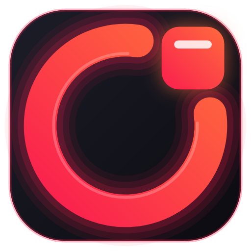
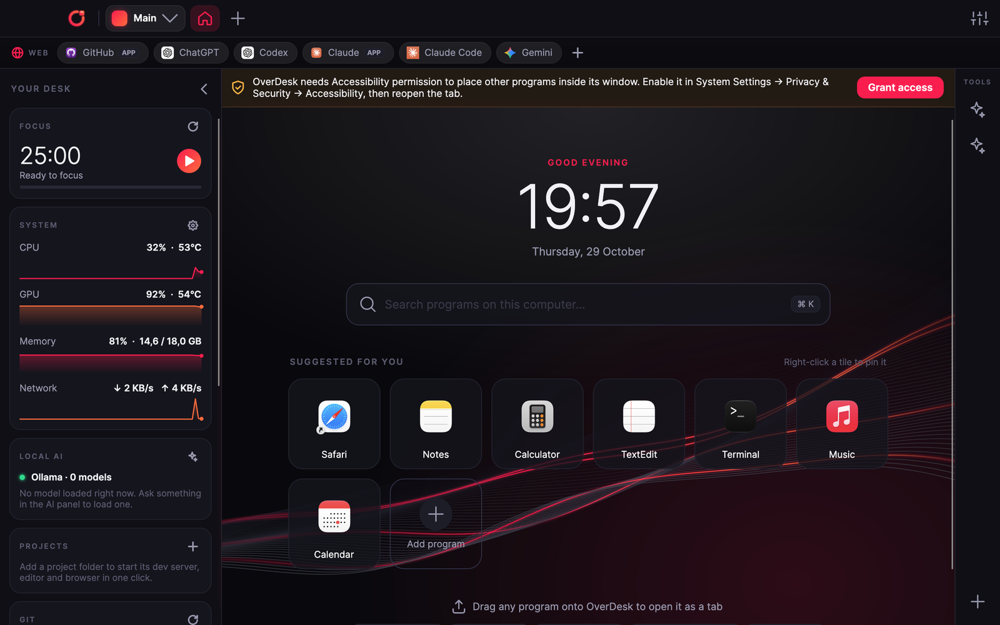
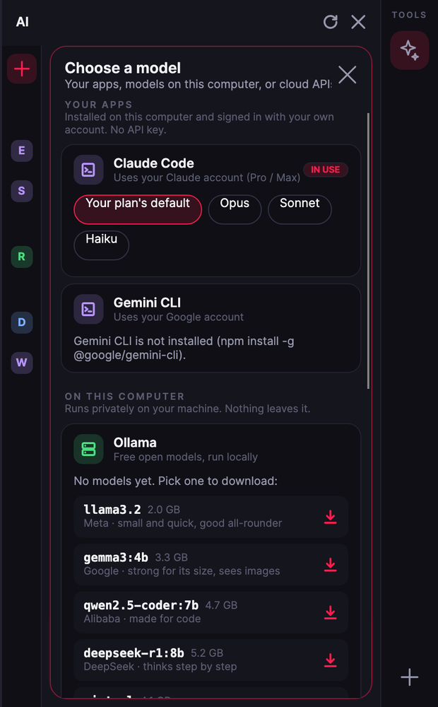
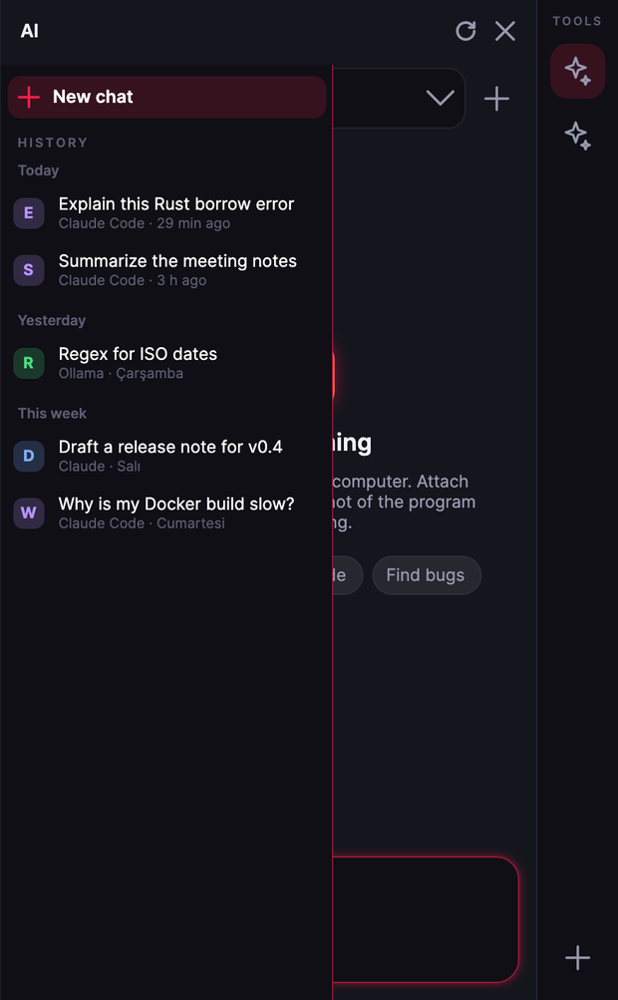
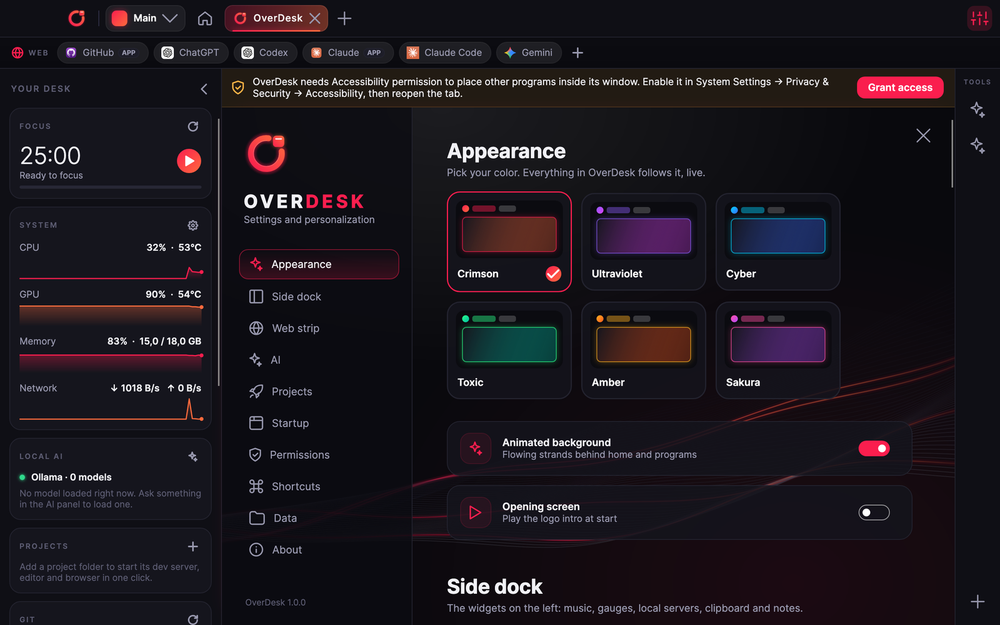
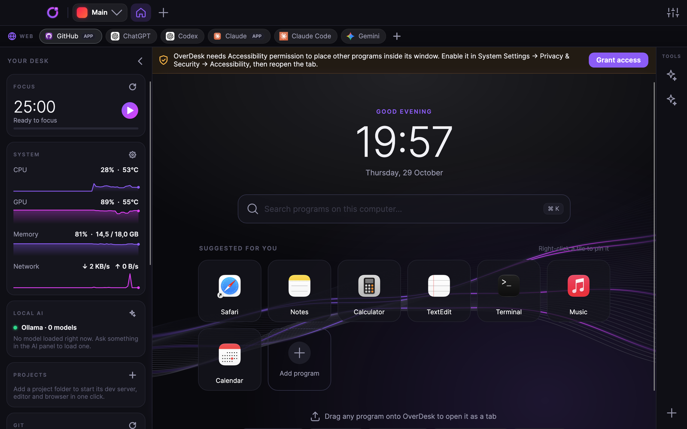

<p align="center">
  
</p>

<h1 align="center">OverDesk</h1>

<p align="center">
  One window for all your programs. A desktop "umbrella" app for macOS and Windows, built with Avalonia and .NET.
</p>

<p align="center">
  
</p>

> **Status: early (0.1).** The UI is complete and runs on macOS. The Windows layer compiles and CI builds it,
> but nobody has run it on a real Windows machine yet. Testers and contributors are very welcome.

## What it does

- **Programs as tabs.** Any installed program becomes a tab at the top. Drag it onto the window or press **+**.
  On Windows the program's window is reparented into OverDesk. On macOS, which does not allow that, the window is glued
  to OverDesk's stage: it follows moves and resizes and comes back if dragged away.
- **Web strip.** A second row for GitHub, ChatGPT, Codex, Claude, Claude Code and Gemini (or any site you add).
  If the desktop app is installed it opens that; otherwise the site opens in a built-in web view.
- **AI panel.** One chat for:
  - AI apps you already have: Claude Code with your own Claude account, Gemini CLI;
  - models on your computer: Ollama (download models right from the panel) and LM Studio;
  - cloud APIs: Claude, OpenAI, Gemini, with keys kept in the system keychain.

  You can attach the clipboard or a screenshot of the program you are using, and keep a history of past chats.
- **Side dock.** The left side holds a set of cards:
  - Now Playing mini player;
  - CPU / GPU / RAM / temperature gauges;
  - local dev servers;
  - clipboard history and a scratchpad;
  - focus timer;
  - projects, git and Docker cards.
- **Workspaces, split view, command palette (⌘P), themes**: six accent colors that recolor everything live.
- **Tools panel + plugins.** The right side hosts tools. A tool is a folder with an `overdesk.plugin.json`; it can be a
  C# plugin or any program in any language. See [docs/PLUGINS.md](docs/PLUGINS.md).

<p align="center">
  
  &nbsp;
  
</p>
<p align="center">
  
  &nbsp;
  
</p>

## Run it

You need the [.NET 10 SDK](https://dotnet.microsoft.com/download).

```bash
git clone https://github.com/ersanulker08/OverDesk.git
cd OverDesk
dotnet run --project src/Overdesk.App
```

The same command works on macOS and Windows. Each OS builds its own flavor automatically.

### Build a real app

| | Command | Output |
|---|---|---|
| macOS | `scripts/package-macos.sh` (or `osx-x64` for Intel) | `dist/OverDesk.app` |
| Windows | `.\scripts\package-windows.ps1` | `dist\OverDesk-win-x64\Overdesk.App.exe` |

Both are self-contained, so no .NET install is needed to run them.

### macOS permissions

macOS asks for these the first time a feature needs them. When you start OverDesk from a terminal, the permission
belongs to the terminal, so use the packaged `OverDesk.app` for day-to-day use.

| Permission | Used for |
|---|---|
| Accessibility | Placing other programs' windows on the stage |
| Screen Recording | The live mirror of a program while OverDesk is in front, and screenshots for the AI |
| Automation | Reading Music / Spotify for the Now Playing card |

## Project layout

```
src/
  Overdesk.App/               Avalonia UI: main window, home, dock, settings, AI panel, palette
  Overdesk.Core/              Tabs, settings, plugin manifest + registry, platform interfaces (no OS code)
  Overdesk.AI/                Chat providers behind IChatProvider (Ollama, LM Studio, OpenAI, Claude, Gemini, Claude Code CLI, Gemini CLI)
  Overdesk.Platform.MacOS/    Accessibility window gluing, WKWebView, keychain, media, system stats
  Overdesk.Platform.Windows/  Win32 reparenting, WebView2, Credential Manager, media, system stats
samples/HelloTool/            A minimal in-process tool plugin
scripts/                      Packaging for macOS and Windows
```

The core never knows which OS it runs on. Everything OS-specific sits behind interfaces in
`Overdesk.Core/Platform` and is implemented once per platform.

## Developer tips

- `OVERDESK_DATA_DIR=<folder>` uses a throwaway settings folder instead of your real one.
- `OVERDESK_SNAPSHOT=<folder>` renders the main screens to PNG files and quits, which is handy for checking UI changes.
  `OVERDESK_SNAPSHOT_TOOL=<plugin id>` also opens a tool.
- Check the Windows build from a Mac: `dotnet build src/Overdesk.App -p:OS=Windows_NT -p:EnableWindowsTargeting=true`.

## Contributing

Issues and pull requests are welcome, especially testing on Windows. Read [CONTRIBUTING.md](CONTRIBUTING.md) first.

## License

[MIT](LICENSE)
